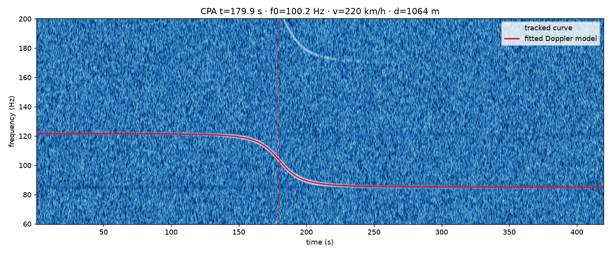
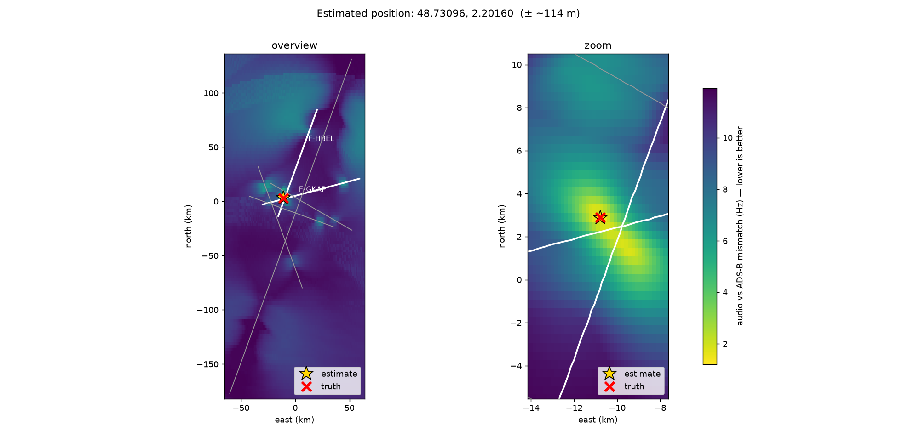

# doppler-locate

Find **where and when** a video was filmed from the sound of aircraft flying overhead.

A passing aircraft leaves a Doppler curve in the audio: its tone is higher while it approaches and lower while it moves away, even when you can barely hear it. The shape of that curve gives the time of closest approach, the aircraft's speed and its distance from the microphone. Matching it against public ADS-B tracks (the positions aircraft broadcast continuously) reveals where the sound was recorded. With two aircraft, the point is unique.



## Install

```bash
pip install -r requirements.txt
```

You also need [ffmpeg](https://ffmpeg.org/) on your PATH to read audio from video files.

## Usage

**1. Spot aircraft in the spectrogram**

```bash
python doppler_locate.py spectro video.mp4 --fmin 40 --fmax 500
```

Look for a falling S-shaped curve. Note its frequency range and when it appears.

**2. Fit the Doppler curve of each aircraft**

```bash
python doppler_locate.py fit video.mp4 --fmin 60 --fmax 220 --t0 0 --t1 300 -o plane1.json
```

The script prints the time of closest approach, the engine tone, the speed and the minimum distance. The recording start time is read from the video metadata; if it is missing, pass `--start 2026-11-17T18:15:00Z`.

**3. Locate with ADS-B tracks**

```bash
python doppler_locate.py locate plane1.json plane2.json --tracks adsb.csv --tol 120
```

`adsb.csv` holds one row per position with the columns `flight, time, lat, lon, alt_m`. Column names from OpenSky (`icao24`, `geoaltitude`…) and ADS-B Exchange (`hex`, `alt_baro` in feet…) are recognized too. `--tol` is the camera clock uncertainty in seconds; the search sweeps over it. `--elev` sets the ground elevation if you know it.

The output is a position, a Google Maps link and a map of the mismatch between the audio and every candidate point.



## Demo

```bash
python doppler_locate.py demo
```

The demo generates a 20-minute synthetic recording: two propeller planes fly by 920 s apart, with four other aircraft as decoys and background noise. It then runs the whole pipeline. The recovered point lands about ten meters from the true position.

## How it works

- **Whitened spectrogram**: each frequency bin is normalized over the whole recording, which removes constant noise (fans, 50/60 Hz mains hum) and leaves what moves.
- **Curve tracking**: a Viterbi search picks the strongest, most continuous path through the spectrogram.
- **Doppler model**: aircraft on a straight line at constant speed, `f = f0 · c / (c + v_r)`, with the sound propagation delay handled exactly.
- **Location**: for each point of a grid, the script predicts the curve each ADS-B track would have produced and keeps the point that matches best. The search runs on a coarse grid, then two zooms.

## Limitations

- Aircraft must be close enough, and the surroundings quiet enough, for the curve to rise above the noise.
- The model assumes a straight flight path during the pass.
- With a single aircraft there is a mirror solution on the other side of its flight path.
- The speed of sound is fixed at 343 m/s and wind is ignored.

## License

MIT
